## Part 1. Готовый докер

1) 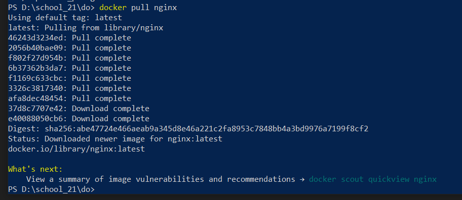
Скачал докер-образ с nginx

2) 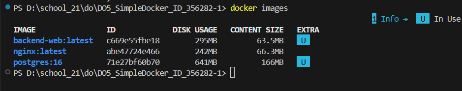
Проверка наличие докер образа через docker-images/image

3) 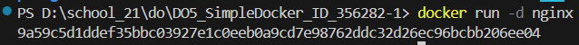
Создал контейнер и видим ID контейнера

4) 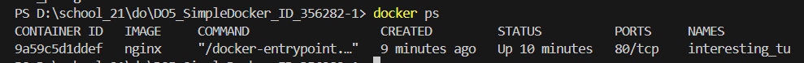
Проверил, что контейнер запустился

5) Выполнение команды - docker inspect interesting_tu
   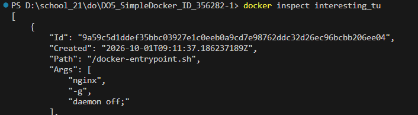

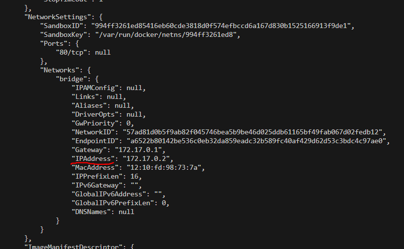
IP адрес контейнера

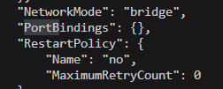
Видим что запампленных портов нет

Ввожу docker inspect --size interesting_tu чтобы узнать размер контейнера
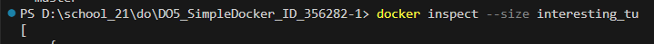

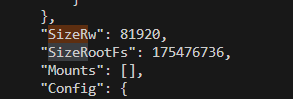
Размеры в байтах. SizeRootFs - размер файловой системы контейнера. 
SizeRw - объём данных, которые контейнер записал поверх исходного образа.

6) 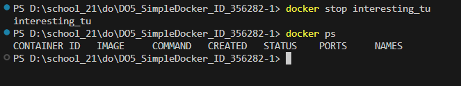
Остановка контейнера и проверка что он остановился

7) 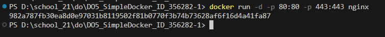
Запустил докер с портами 80 и 443 в контейнере
-p ХОСТ:КОНТЕЙНЕР

8) 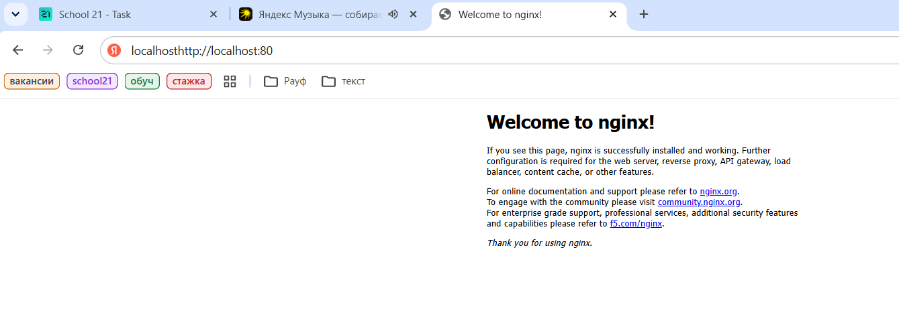
Вывод страницы в браузере по ссылке - http://localhost:80

9) 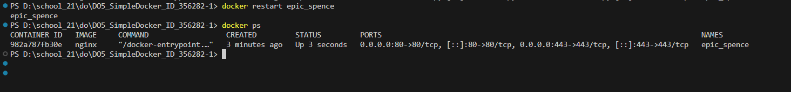
Рестарт и проверка того, что контейнер запустился

## Part 2. Операции с контейнером

1) 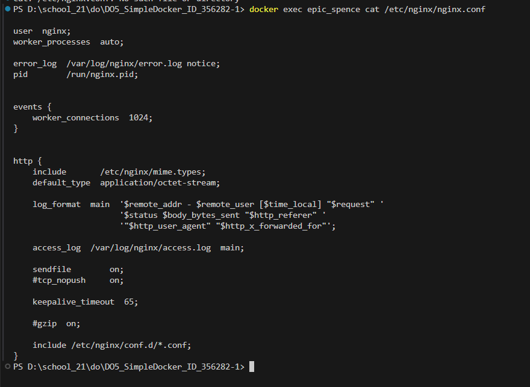
Прочитал конфигурационный файл nginx.conf

2) Далее создаю nginx.conf на локальной машине
   
3) 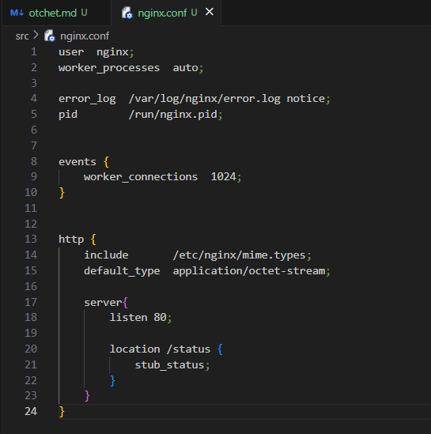 
   
В данном фале добавляю путь /status для отдачи страницы статуса сервера

4) 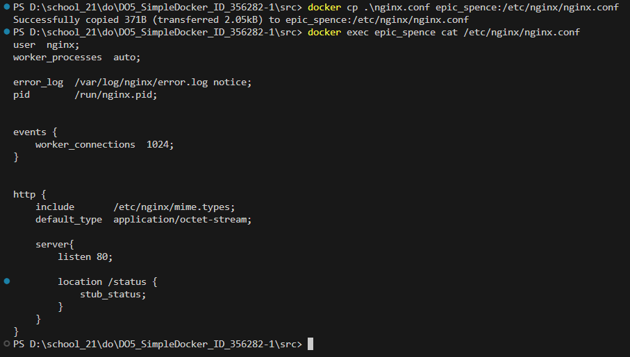
Скопировал конфиг из локальной машины в докер. Потом проверил что мой файл перенесся

5) 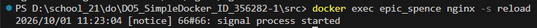
Перезапустил nginx

6) 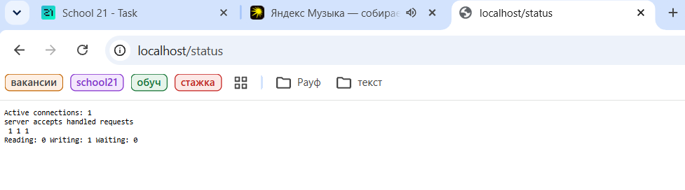
Проверка работы /status в браузере

7) 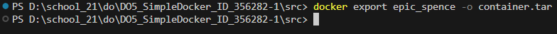
Скопировал container.tar

8) 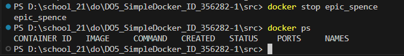
Остановка контейнера и проверка

9) 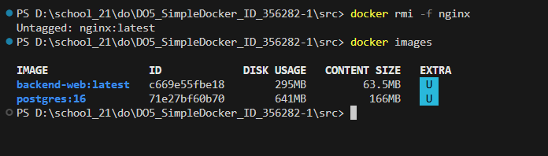
Принудительное удаление образа и проверка

10)  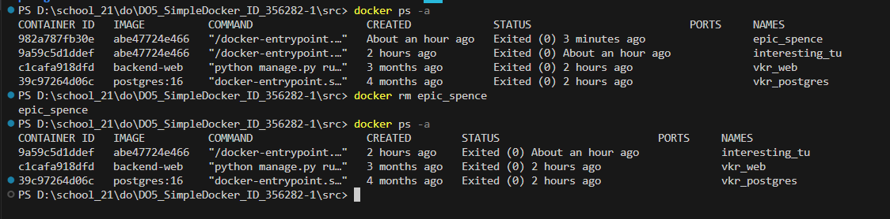
Удаление контейнера и проверка

11)  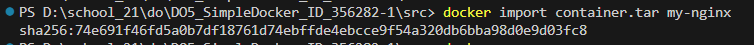
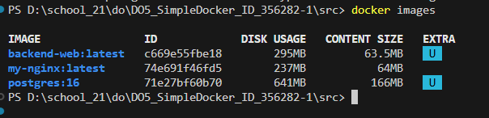
Создал образ из файла container.tar

12)  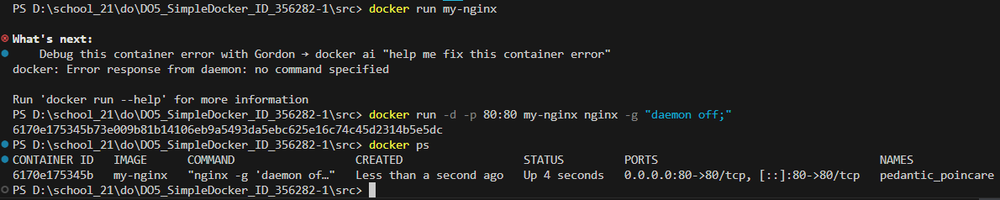
Создание контейнера и проверка на то что он действительно создался

13)  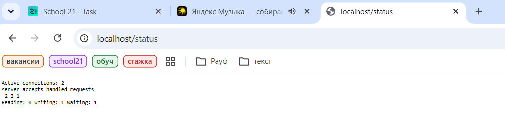
Проверка в браузере страницы /status

## Part 3. Мини веб-сервер

1) 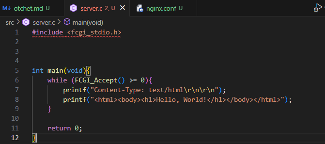
Мини сервер на Си

2) 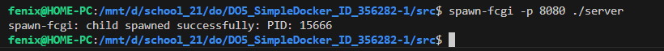
Запуск сервера на порту 8080

3) 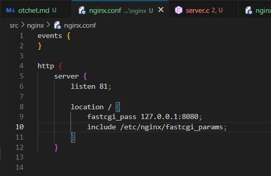
nginx.conf который проксирует все запросы с 81 порта на 127.0.0.1:8080

4) 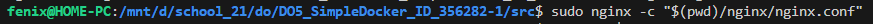
локальный запуск nginx с написанной конфигурацией

5) 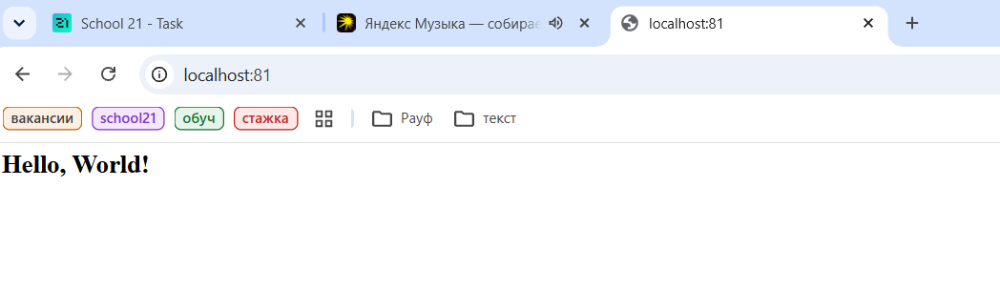 
Проверка через браузер

## Part 4. Свой докер

1) 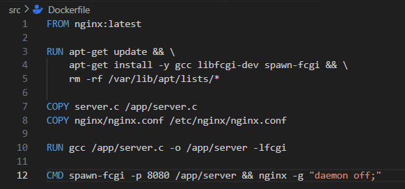
1) собирает исходники мини сервера на FastCgi из Части 3;
2) запускает его на 8080 порту;
3) копирует внутрь образа написанный ./nginx/nginx.conf;
4) запускает nginx.

2) 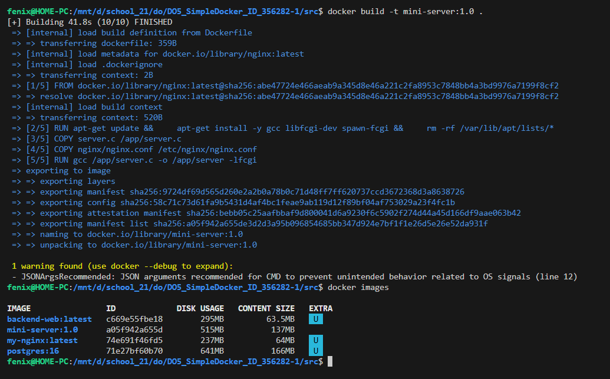
Сборка докер образа, указав имя и тег. + проверка через docker images

3) 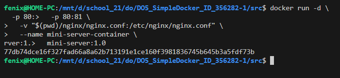
запускаю собранный докер образ с маппингом 81 порта на 80 на локальной машине и маппингом папки ./nginx внутрь контейнера по адресу, где лежат конфигурационные файлы nginx'а 

4) 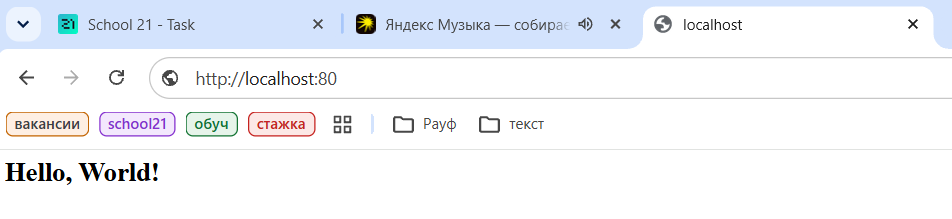
Проверяю в браузере работу контейнера

5) 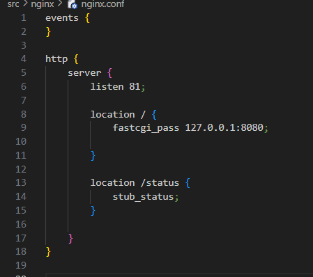
Дописал /status в конфиг

6) 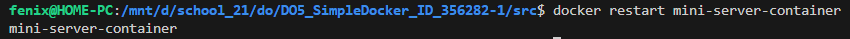
Перезапуск контейнера

7) 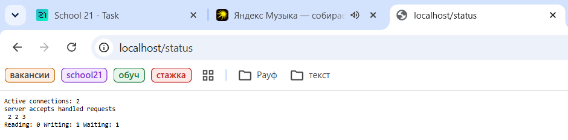
Проверка добавленного /status

## Part 5. Dockle

1) 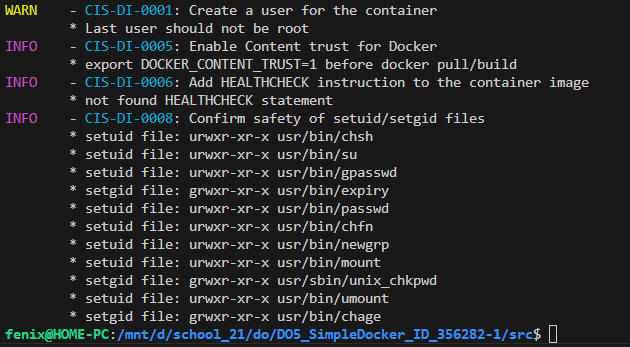
Запуск Dockle. 1 ошибка и 1 предупреждение

2) 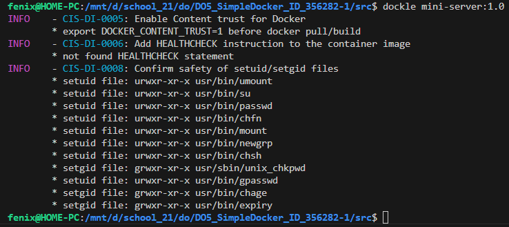
Ошибок нет

3) 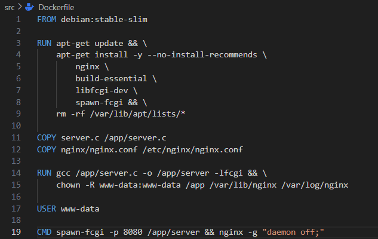
Был исправлен Dockerfile 

## Part6. Базовый Docker Compose

1) 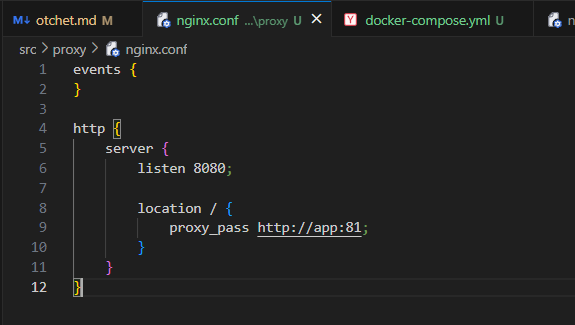
Теперь proxy слушает 8080 и отправляет на порт 81 

2) 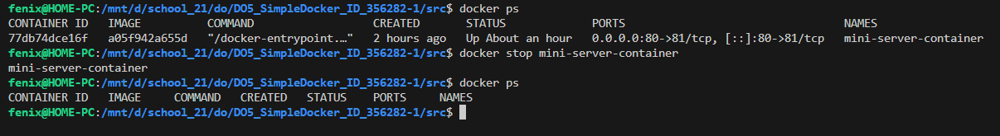
Останавливаю все запущенные контейнеры

3) 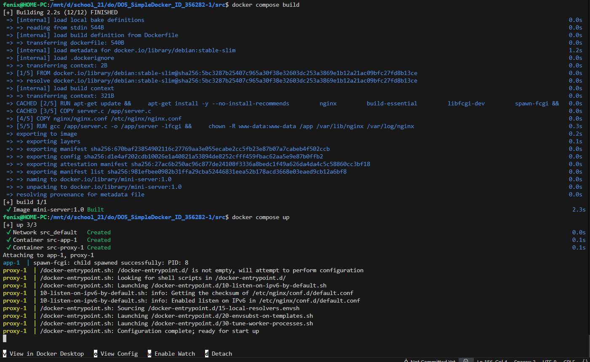
Запустил проект с помощью команд docker compose build и docker compose up

4) 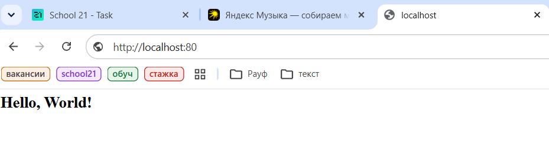
Проверка в браузере